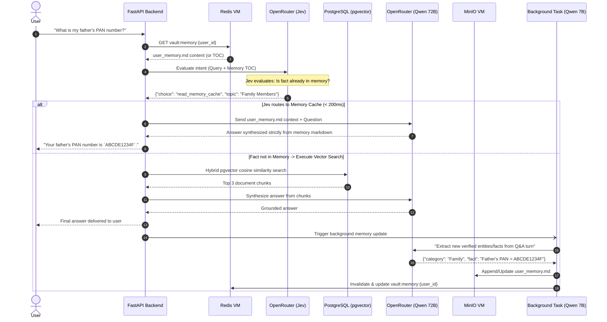

# Vault City AI: Unified OpenRouter (Jev + Qwen) & Dynamic Memory Architecture

This architecture blueprint unifies the entire AI intelligence layer through **OpenRouter**, deploying **Jev** for instant typed JSON decisions, **Qwen 2.5** for high-context synthesis, and a **dynamic per-user markdown knowledge file (`user_memory.md`)** stored in MinIO and hot-cached in Redis.

---

## 1. System Architecture Overview

```mermaid
flowchart TD
    subgraph Clients ["Client Layer"]
        PWA["Cloudflare Pages / PWA Frontend"]
    end

    subgraph HostCompute ["AWS EC2 Backend Stack"]
        API["FastAPI Backend (:8000)"]
        PG[("PostgreSQL 16 + pgvector")]
        MemoryService["Memory Service (CRUD & Parser)"]
    end

    subgraph StateStorage ["State & External Services"]
        RedisVM[("Remote Redis VM (Hot Memory Cache)")]
        MinIOVM[("MinIO / R2 Storage (user_memory.md & Vault Files)")]
        ClamAVVM["Remote ClamAV VM (Antivirus)"]
    end

    subgraph CloudflareLayer ["Cloudflare Free Tier"]
        CFVision["Cloudflare Workers AI\n(Llama 3.2 11B Vision - Images Only)"]
    end

    subgraph OpenRouterGateway ["OpenRouter Unified AI Gateway"]
        JevModel["typesafe/jev & jev-router\n(Sub-200ms Typed Decisions)"]
        QwenHeavy["qwen/qwen-2.5-72b-instruct\n(Deep RAG & Multi-turn Synthesis)"]
        QwenLight["qwen/qwen-2.5-7b-instruct\n(Fast Context & Fact Distillation)"]
    end

    PWA -->|1. User Query / Upload| API
    
    %% Ingestion Flow
    API -->|Inspect Text vs Image| CFVision
    API -->|Antivirus Stream| ClamAVVM
    API -->|Upload Verified Object| MinIOVM
    API -->|Store Chunks & Embeddings| PG
    
    %% Query Flow with Jev
    API -->|2. Route Intent| JevModel
    JevModel -->|3. Decision: memory_cache / rag / deep| API
    
    %% Memory Flow
    API <-->|Fast Memory Read/Write (<2ms)| RedisVM
    MemoryService <-->|Persist user_memory.md| MinIOVM
    
    %% Synthesis Flow
    API -->|4. If RAG needed| PG
    API -->|5. Final Synthesis| QwenHeavy
    
    %% Post-Chat Background Memory Extraction
    API -.->|6. Async Fact Distillation| QwenLight
    QwenLight -.->|Append Verified Facts| MemoryService
```

---

## 2. The Core Innovations

### A. Unified OpenRouter Gateway
Instead of maintaining multiple SDKs, credentials, and billing accounts (Anthropic, OpenAI, custom routers):
- **Single API Endpoint:** `https://openrouter.ai/api/v1/chat/completions`
- **Single Secret:** `OPENROUTER_API_KEY`
- **Models Utilized:**
  1. **`typesafe/jev` / `typesafe/jev-router`:** Evaluates state and returns typed JSON choices in ~150ms.
  2. **`qwen/qwen-2.5-72b-instruct`:** Deep document reasoning and RAG answers (~95% cheaper than Claude Sonnet).
  3. **`qwen/qwen-2.5-7b-instruct`:** Fact extraction, JSON parsing, and memory distillation ($0.04/1M tokens).

### B. Dynamic User Profile Markdown Memory (`user_memory.md`)
Every user gets an isolated Markdown sheet stored in MinIO:
- **Location:** `s3://vault-secured/{user_id}/profile/user_memory.md`
- **Hot Cache:** Cached in Redis as `vault:memory:{user_id}` (1 millisecond read latency).
- **Purpose:** Acts as a **Level-1 Personal Context Cache**. Queries like *"What is my PAN number?"* or *"What is my mother's DOB?"* are answered directly from this file without scanning thousands of document vectors.

---

## 3. End-to-End Chat Flow with Jev & Memory



---

## 4. `user_memory.md` Schema & Structure

```markdown
# Personal Memory Vault
- **User ID:** `2d471c7f-d643-4841-be10-73227962cddb`
- **Last Synced:** `2026-11-27T12:00:00Z`

## 1. Government & Identity Records
- **Legal Name:** Manas ...
- **Aadhaar Number:** `XXXX-XXXX-1234` | Source: `aadhaar_card.pdf`
- **PAN Number:** `ABCDE1234F` | Source: `pan_card.jpg`
- **Date of Birth:** `199X-XX-XX`
- **Blood Group:** `O+`

## 2. Family & Dependents
- **Father:** Name: `Ramesh ...` | PAN: `ABCDE5678K` | DOB: `1965-04-10`
- **Mother:** Name: `Sita ...` | Aadhaar: `XXXX-XXXX-9876`

## 3. Financial & Accounts
- **Primary Bank:** HDFC Bank | Savings A/C: `...5542` | IFSC: `HDFC0001234`
- **Credit Card:** Axis Bank Neo (Last 4 digits: `8821`)
- **Provident Fund (UAN):** `10092182910`

## 4. Recurring Utilities & Bills
- **Electricity Connection:** Consumer #`902184`, Meter #`M-44021` | Provider: `BESCOM`
- **Broadband:** Airtel Xstream | Account #`08044219`

## 5. User Directives & Preferences
- Preferred response format: Bullet points with values in backticks.
- Address: Bangalore, Karnataka, India.
```

---

## 5. Jev Decision Gate Design

Jev is invoked across three distinct gates using OpenRouter's structured endpoint:

### Gate 1: Master Query Dispatcher (`agentic_rag.py`)
* **Prompt/Instruction:** *"Classify user query into the fastest resolution lane."*
* **Context:** Query + Summary of available memory sections.
* **Choices:**
  - `memory_cache`: Fact is explicitly present in `user_memory.md`.
  - `single_shot_rag`: Requires searching document chunks for a specific factual answer.
  - `deep_investigator`: Multi-hop query requiring comparisons, date math, or interactive user choice.
  - `casual_conversation`: Greetings, chitchat, or generic non-vault questions.

### Gate 2: Ingestion Content Router (`vision_service.py`)
* **Context:** Mime type, extension, extracted digital text length.
* **Choices:**
  - `digital_text`: Native text found ($> 30$ chars). Bypass vision entirely.
  - `scanned_image`: Pure image or empty photocopy scan. Route to Cloudflare Workers AI Vision.
  - `unreadable_noise`: Corrupted binary or unparseable junk.

### Gate 3: Model Complexity Dispatcher (`llm_router.py`)
* **Context:** Complexity of synthesis required.
* **Choices:**
  - `qwen_7b`: Simple 1-sentence formatting or profile answer.
  - `qwen_72b`: Deep synthesis across multiple conflicting documents.

---

## 6. Strict Ingestion Gate: Files vs. Images

To ensure zero token waste on Cloudflare Vision:

| Uploaded File Type | Processing Path | Vision Model Invoked? | Cost |
| :--- | :--- | :--- | :--- |
| **`.txt`, `.csv`, `.json`, `.md`** | Python native string decode | **NO** | **$0.00** |
| **`.docx`, `.doc`** | `python-docx` extraction | **NO** | **$0.00** |
| **Digital `.pdf`** (text $> 30$ chars) | `pypdf` stream extraction | **NO** | **$0.00** |
| **Scanned `.pdf`** (text $< 30$ chars) | Rasterize first page image | **YES** (Cloudflare Workers AI) | **$0.00** (Free Neurons) |
| **`.png`, `.jpg`, `.jpeg`, `.webp`** | Clean & normalize JPEG | **YES** (Cloudflare Workers AI) | **$0.00** (Free Neurons) |

---

## 7. Implementation Checklist & File Roadmap

| Phase | Target File | Action |
| :--- | :--- | :--- |
| **1. OpenRouter Client** | `backend/app/services/openrouter_client.py` | Create centralized client handling `typesafe/jev` and `qwen/qwen-2.5-*` with token tracking. |
| **2. Memory Engine** | `backend/app/services/memory_service.py` | Implement `get_user_memory()`, `update_user_memory()`, Redis hot-cache, and MinIO sync. |
| **3. Jev Router Integration** | `backend/app/services/agentic_rag.py` | Replace regex rules with Jev decision call + Memory fast lane. |
| **4. Ingestion Guard** | `backend/app/services/ingestion_service.py` | Enforce strict digital vs. image routing; hook Cloudflare Workers AI Vision. |
| **5. Cleanup Anthropic** | `backend/app/services/claude_tracker.py` | Deprecate Anthropic API calls; route all LLM traffic through OpenRouter. |
| **6. Background Fact Extractor**| `backend/app/api/v1/chat.py` | Add `BackgroundTasks` hook to distill Q&A turns into `user_memory.md`. |
