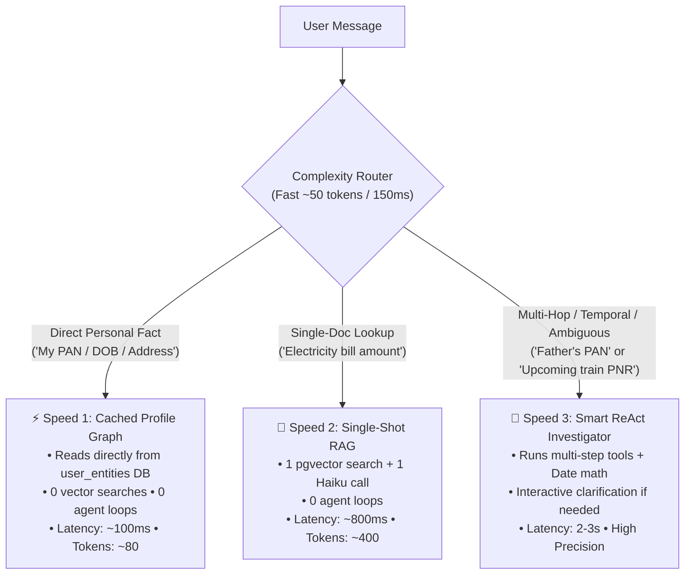
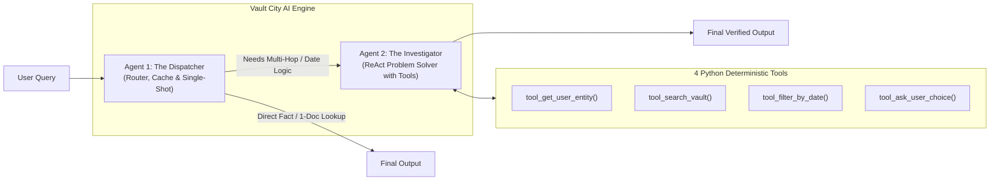
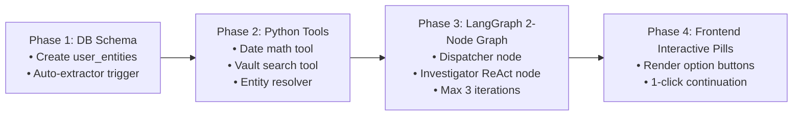

# Lean 2-Agent Architecture Plan: Multi-Hop Reasoning, Temporal Filtering & Interactive Clarification

**Target System:** Vault City AI Assistant (`backend/app/services/rag_workflow.py`)  
**Design Principle:** Few, deterministic, smart agents with Python tools—avoiding slow, token-heavy micro-agent armies.

---

## 1. Problem Statement & Motivation

Standard "Naive RAG" (Query $\rightarrow$ Vector Search $\rightarrow$ LLM generation) fails repeatedly on personal document vaults:
1. **Indirect / Multi-Hop Entities**: When a user asks *"What is my father's PAN?"*, searching for "father's PAN" fails if the document is titled `ramesh_pan.pdf` with no mention of the word "father".
2. **Temporal & Date Arithmetic**: When a user asks *"What is the PNR of my BBSR to Vizag train?"*, vector search returns past, expired tickets from months ago. LLMs hallucinate dates and cannot reliably determine which ticket is upcoming.
3. **Ambiguity & Guessing**: When multiple valid tickets or salary slips exist, standard RAG picks one randomly rather than interactively clarifying with the user.
4. **Latency & Token Waste**: Over-engineered agent systems spin up 5–10 LLM agents even for simple queries like *"What is my PAN?"*, wasting tokens and taking 10+ seconds.

---

## 2. Core Architectural Philosophy: The Adaptive 3-Speed Pipeline

Every query passes through an **Adaptive Complexity Router** that sends the query down one of three speeds:



- **85% of queries** hit Speed 1 or Speed 2: Immediate, cheap, zero spinning.
- **15% of queries** hit Speed 3: Full multi-hop agent intelligence with mathematical and factual verification.

---

## 3. The Two-Agent Architecture



### Agent 1: The Dispatcher (Router & Cache)
- **Role**: High-speed triage and intent classifier.
- **Model**: Claude 3.5 Haiku (or Gemini 2.0 Flash) with temperature `0.0`.
- **Inputs**: User query + Vault Document Catalog (list of filenames and categories).
- **Decisions**:
  - `PROFILE_LOOKUP`: User is asking for their own direct identity detail (PAN, Aadhaar, DOB, Blood Group) $\rightarrow$ Fetch from `user_entities` table and return immediately.
  - `DIRECT_RAG`: Single unambiguous file query $\rightarrow$ Run 1 `pgvector` search, call Haiku, format in backticks (`value`), and return.
  - `INVESTIGATE`: Multi-hop query, temporal constraint, or cross-document comparison $\rightarrow$ Hands over to Agent 2 with an explicit objective.

---

### Agent 2: The Investigator (The ReAct Problem Solver)
- **Role**: Autonomous multi-step investigator that loops through reasoning steps and tools (max 3 iterations).
- **Model**: Claude 3.5 Haiku / Gemini 2.0 Flash.
- **Loop**: `Thought` $\rightarrow$ `Action (Tool Call)` $\rightarrow$ `Observation` $\rightarrow$ `Next Step / Final Answer`.
- **Constraint**: It does **not** call other LLM agents. It only invokes deterministic Python functions.

---

## 4. The 4 Deterministic Python Tools

Python code is **free, instant, and 100% mathematically accurate**. Giving 1 smart agent 4 Python tools eliminates the need for extra LLM agents.

### Tool 1: `tool_get_user_entity(entity_key: str) -> Optional[str]`
- **Purpose**: Retrieves a known fact about the user or their immediate circle from the `user_entities` table.
- **Keys**: `father_name`, `mother_name`, `spouse_name`, `dob`, `pan_number`, `passport_number`, `home_city`, etc.
- **Example Call**: `tool_get_user_entity("father_name")` $\rightarrow$ Returns `"Ramesh Charchi"`.

### Tool 2: `tool_search_vault(query: str, doc_name_filter: Optional[str] = None, top_k: int = 5) -> List[Dict]`
- **Purpose**: Runs hybrid retrieval (PostgreSQL `pgvector` HNSW cosine similarity + full-text keyword matching).
- **Optional Filter**: If `doc_name_filter="ticket"`, only searches chunks originating from files containing "ticket" in their name or category.

### Tool 3: `tool_filter_by_date(items: List[Dict], date_key: str, mode: str = "upcoming", reference_date: Optional[str] = None) -> List[Dict]`
- **Purpose**: Pure Python `datetime` comparison. Never lets the LLM perform date math.
- **Modes**:
  - `upcoming`: Filters `item[date_key] >= today`, sorted chronologically (nearest upcoming first).
  - `past`: Filters `item[date_key] < today`, sorted reverse-chronologically (most recent past first).
  - `latest`: Returns the single item with the highest date.
- **Reference Date**: Defaults to `datetime.now(timezone.utc).date()`.

### Tool 4: `tool_ask_user_choice(question: str, options: List[Dict[str, str]]) -> Dict`
- **Purpose**: Emits an interactive choice payload to the frontend when multiple valid answers exist, preventing hallucination or arbitrary guessing.

---

## 5. Database Schema Addition: `user_entities`

Add a lightweight relational table in PostgreSQL:

```sql
CREATE TABLE IF NOT EXISTS user_entities (
    id UUID PRIMARY KEY DEFAULT gen_random_uuid(),
    user_id UUID NOT NULL REFERENCES users(id) ON DELETE CASCADE,
    entity_key VARCHAR(64) NOT NULL,       -- e.g. 'father_name', 'dob', 'pan', 'aadhaar', 'blood_group'
    entity_value VARCHAR(255) NOT NULL,     -- e.g. 'Ramesh Charchi', '1998-04-12', 'CGGPC3460G'
    entity_label VARCHAR(128),              -- Human-readable label: "Father's Full Name"
    source_file_id UUID REFERENCES files(id) ON DELETE SET NULL,
    confidence NUMERIC(4, 3) DEFAULT 1.000,
    created_at TIMESTAMPTZ DEFAULT NOW(),
    updated_at TIMESTAMPTZ DEFAULT NOW(),
    CONSTRAINT uq_user_entity UNIQUE (user_id, entity_key)
);

CREATE INDEX IF NOT EXISTS idx_user_entities_lookup ON user_entities(user_id, entity_key);
```

### Auto-Population Pipeline
During document ingestion (in Lambda 1 / Lambda 2):
- When an **Identity Document** (Passport, Aadhaar, PAN, Driving License, Resume) is processed:
- A regex / lightweight NLP entity extractor runs over the text:
  - If `Father's Name: <Name>` is detected $\rightarrow$ upserts into `user_entities` (`entity_key='father_name'`).
  - If `DOB: <Date>` is detected $\rightarrow$ upserts into `user_entities` (`entity_key='dob'`).
  - If `PAN: <Number>` is detected $\rightarrow$ upserts into `user_entities` (`entity_key='pan_number'`).

---

## 6. End-to-End Execution Walkthroughs

### Walkthrough A: "What is my father's PAN?"
1. **User asks**: *"What is my father's PAN?"*
2. **Agent 1 (Dispatcher)**: Recognizes an indirect reference ("father's PAN"). Direct user PAN is not what's asked. Routes to **Agent 2 (Investigator)**.
3. **Agent 2 (Turn 1)**:
   - *Thought*: "I need the father's PAN. First, I need to know the father's name."
   - *Action*: `tool_get_user_entity("father_name")`
   - *Observation*: `"Ramesh Charchi"` (sourced from `passport.pdf`).
4. **Agent 2 (Turn 2)**:
   - *Thought*: "Now search for Ramesh Charchi's PAN."
   - *Action*: `tool_search_vault("Ramesh Charchi PAN card income tax", doc_name_filter="pan")`
   - *Observation*: Found chunk in `ramesh_pan.pdf`: *"Income Tax Department ... Ramesh Charchi ... Permanent Account Number: ABCPR1234K"*.
5. **Agent 2 (Turn 3)**:
   - *Thought*: "Found verified PAN for Ramesh Charchi. Formulating answer."
   - *Output*: `Your father Ramesh Charchi's PAN is `ABCPR1234K`.` (Source: `ramesh_pan.pdf`).

---

### Walkthrough B: "What is the PNR of my BBSR to Vizag train?"
1. **User asks**: *"What is the PNR of my BBSR to Vizag train?"*
2. **Agent 1 (Dispatcher)**: Detects travel route + temporal intent ("train ticket"). Routes to **Agent 2**.
3. **Agent 2 (Turn 1)**:
   - *Thought*: "Search for train tickets between Bhubaneswar/BBSR and Visakhapatnam/Vizag."
   - *Action*: `tool_search_vault("BBSR to Vizag Bhubaneswar Visakhapatnam train ticket PNR")`
   - *Observation*: Returns 3 tickets:
     - Ticket 1: 12-Oct-2026, PNR `2184920111`, Prashanti Exp
     - Ticket 2: 02-Dec-2026, PNR `6428192031`, Coromandel Exp
     - Ticket 3: 15-Dec-2026, PNR `8192034912`, Vande Bharat Exp
4. **Agent 2 (Turn 2)**:
   - *Thought*: "Filter these tickets using Python date logic against today's date."
   - *Action*: `tool_filter_by_date(tickets, date_key="journey_date", mode="upcoming")`
   - *Observation*: Ticket 1 (Oct 12) is discarded as expired. Tickets 2 & 3 are upcoming.
5. **Agent 2 (Turn 3)**:
   - *Thought*: "There are two upcoming tickets. I should not guess. I will ask the user which journey they want."
   - *Action*: `tool_ask_user_choice(question="I found 2 upcoming journeys from BBSR to Vizag in your vault. Which one would you like the PNR for?", options=[{"label": "Dec 2 • Coromandel Exp", "value": "6428192031"}, {"label": "Dec 15 • Vande Bharat", "value": "8192034912"}])`
6. **Frontend UI renders**:
   ```
   va: I found 2 upcoming journeys from BBSR to Vizag in your vault. Which one would you like the PNR for?
   [ 🚄 Dec 2 • Coromandel Exp ]   [ 🚄 Dec 15 • Vande Bharat ]
   ```
7. User clicks `[Dec 2 • Coromandel Exp]` $\rightarrow$ Assistant replies instantly: `The PNR for your journey on Dec 2 is `6428192031`.`

---

## 7. Frontend Integration Schema (Interactive Choice Pills)

When the backend returns an interactive clarification, the REST response structure in `backend/app/schemas/conversation.py` provides:

```json
{
  "id": "asst-msg-uuid",
  "sender": "assistant",
  "content": "I found 2 upcoming journeys from BBSR to Vizag. Which one do you need?",
  "interactive_options": [
    {
      "id": "opt-1",
      "label": "Dec 2 • Coromandel Exp",
      "prompt_payload": "Give me the PNR for the Dec 2 Coromandel Express train"
    },
    {
      "id": "opt-2",
      "label": "Dec 15 • Vande Bharat",
      "prompt_payload": "Give me the PNR for the Dec 15 Vande Bharat train"
    }
  ],
  "tokens_used": 680
}
```

In `frontend/src/components/ChatView.tsx`, if `message.interactive_options` is present, it renders interactive pills right under the assistant bubble. Clicking a pill sends `prompt_payload` directly, executing with 0 typing required.

---

## 8. Implementation Roadmap (When Ready to Code)



1. **Phase 1**: Add `user_entities` table and Alembic migration; add extraction during upload for primary identities (Father, DOB, PAN).
2. **Phase 2**: Implement the 4 Python tools in `backend/app/services/agent_tools.py`.
3. **Phase 3**: Refactor `rag_workflow.py` into the 2-agent LangGraph workflow.
4. **Phase 4**: Add `interactive_options` support in `ChatView.tsx` for 1-click decision pills.
